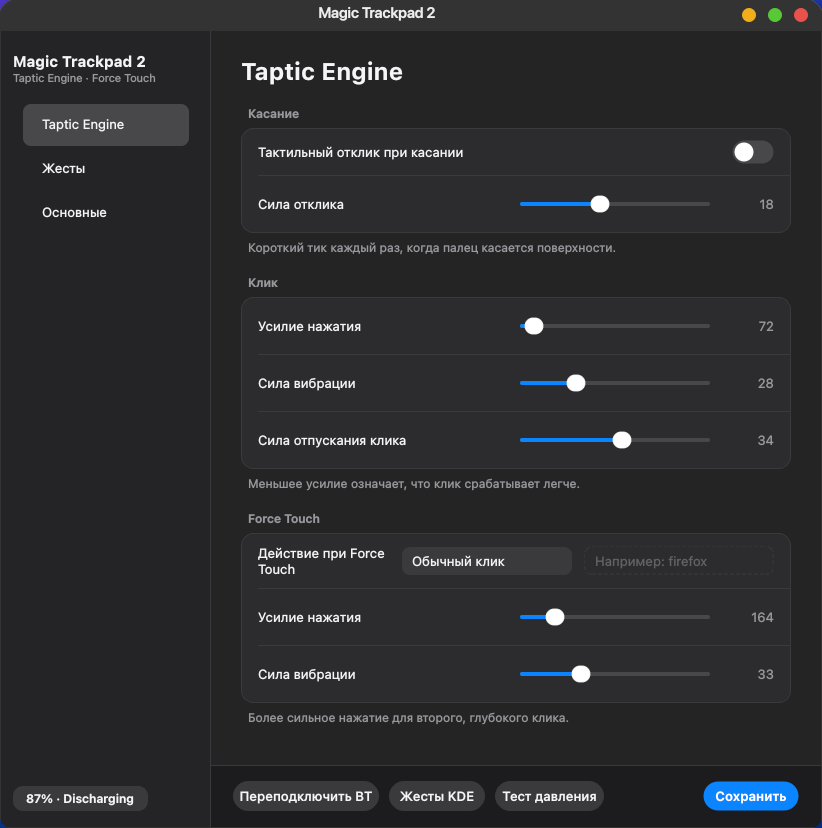
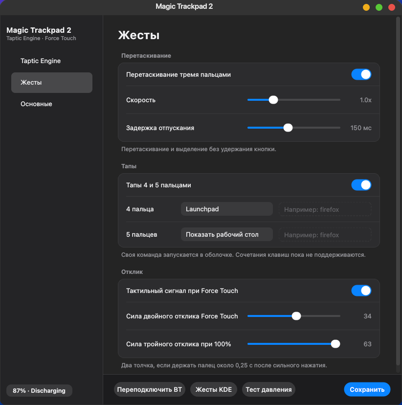
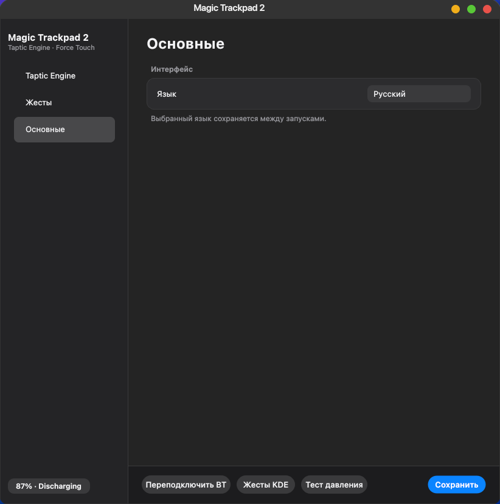
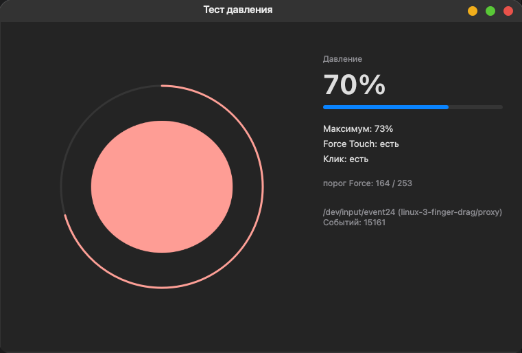

# Apple Magic Trackpad 2 — Force Touch & Gesture Suite for Linux

A macOS-like experience for the **Apple Magic Trackpad 2** on Linux: Force Touch, haptic feedback
from the Taptic Engine, three-finger drag, configurable 4- and 5-finger gestures, and a settings
app with a pressure test window. Works over **Bluetooth** (USB is supported by the driver but less tested).

## Features

- **Force Touch:** a light press is a normal click, a firm press fires a second, deeper action.
  The action is configurable: regular click, context menu, nothing, or your own shell command
  (for example, open an app or search the selected text).
- **Haptic feedback:**
  - a subtle tick when a finger touches the surface (strength adjustable);
  - after a firm press, two short taps if you keep holding for ~0.225 s (the second tap follows 100 ms later).
- **Three-finger drag:** move windows and select text without holding the button.
- **4- and 5-finger gestures:** the 4-finger tap and the 5-finger tap each run an action of your choice
  (default: Launchpad and Show Desktop). Gestures run without haptic feedback.
- **Battery notification:** a notification when the trackpad battery drops to 15% while discharging.
- **Settings app (PyQt6):** sliders and switches, a sidebar layout, light and dark themes that follow
  the system, English and Russian, and a save indicator (no pop-up dialogs).
- **Pressure test window:** a live view of the pressure with a liquid-style bubble, a progress ring,
  colour stages (green → orange → red), and the same two-tap feedback as above. Open it from the settings app.
- **Triple tap at 100% pressure:** three strong taps when the press reaches its maximum, as a "stop" signal.
- **Feedback strength:** separate sliders for the Force Touch double tap and the 100% triple tap.
- **Click release strength:** a slider that sets how strong the release pulse is, applied immediately.

## Screenshots

<p align="center">
  
  
</p>

<p align="center">
  
  
</p>

## Installation (Arch Linux)

```bash
git clone https://github.com/Suyurov/linux-magic-trackpad2-suite.git
cd linux-magic-trackpad2-suite
./setup-suite.sh
```

Run it as your normal user, not with `sudo`: the script asks for `sudo` where it needs it.
Log out and back in once after installation so the `input` group permissions apply.

The installer builds and installs the DKMS driver, writes the configs, udev rules and a narrow sudoers
rule, installs the settings app and the gesture daemon, and starts the services.

## Supported systems

- **Arch Linux with KDE Plasma 6 (Wayland), kernel 7.3.5:** tested, including the full install, uninstall and reinstall cycle.
- **Debian/Ubuntu, Fedora, openSUSE:** the installer detects these package managers, but this is not tested yet.
  `linux-3-finger-drag` is not packaged by the installer for these systems, so three-finger drag needs a manual build.
- **Other desktops:** the driver works on any desktop (it is a kernel module). The settings app runs anywhere with
  PyQt6 and systemd. The 4- and 5-finger gestures and the "KDE gestures" button are KDE-only.

Feedback and logs from `./setup-suite.sh` are very welcome if you try it on another system.

## Using it

Start the settings app from your application menu (**Magic Trackpad 2 Settings**) or run:

```bash
~/.local/bin/magic-trackpad-settings.py
```

- **Taptic Engine:** haptic tick on touch, click and Force Touch thresholds and vibration strength,
  and the Force Touch action.
- **Gestures:** three-finger drag, the 4- and 5-finger gestures, and the haptic feedback switch.
- **General:** interface language.
- **Buttons:** *Reconnect BT* restarts Bluetooth and the services, *KDE gestures* opens the KDE touchpad
  settings (KDE only), *Save* writes everything; *Pressure test* opens the test window.

Settings are stored in:

- `/etc/modprobe.d/hid-magicmouse.conf` — driver parameters (thresholds, vibration, Force Touch action);
- `~/.config/magic-trackpad-suite/gestures.json` — gesture actions, haptic feedback, and advanced timing values;
- `~/.config/magic-trackpad-suite/control-center.conf` — interface language.

Advanced values you can add to `gestures.json` by hand (defaults in brackets):
`force_hold_ms` (225), `force_tap_gap_ms` (100), `force_feedback_strength` (75% of the Force Touch strength),
`feedback_strength` (45), `feedback` (true).

## Uninstall

```bash
./uninstall.sh           # removes the suite and restores the stock kernel driver
./uninstall.sh --purge   # also removes your saved settings and the input-group membership
./uninstall.sh --dry-run # shows what would be removed, changes nothing
```

System packages (DKMS, PyQt6, `linux-3-finger-drag`) are not removed.

## Troubleshooting

- **Force Touch does nothing after installing:** log out and back in (the `input` group), then check
  `ls /sys/module/hid_magicmouse/parameters/ | grep force_action`. The parameter must exist.
- **Middle or context actions do nothing:** the clicks are sent through a virtual mouse (`/dev/uinput`).
  Check `ls -l /dev/uinput` and that your user is in the `input` group.
- **The pressure test window shows no events:** the window reads the proxy device that `linux-3-finger-drag`
  creates. The status line at the bottom of the window shows which device it uses.
- **Haptic taps are too strong or too weak:** adjust `force_feedback_strength` in `gestures.json` (1–63).

## Credits

This driver is based on the following work:

* https://github.com/nexustar/linux-hid-magicmouse
* https://github.com/mwyborski/Linux-Magic-Trackpad-2-Driver
* https://github.com/ponyfleisch/hid-magictrackpad2
* https://github.com/dos1/Linux-Magic-Trackpad-2-Driver

The kernel driver `hid-magicmouse.c` is distributed under GPL-2.0-or-later (see `LICENSE`).
The modifications (Force Touch, haptic feedback, host click tuning) are marked in the file header.
